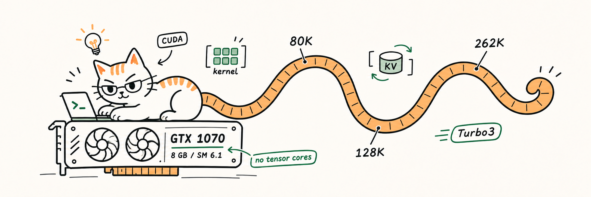

# llama.cpp — pre-tensor-core (Pascal) inference optimizations

<p align="center">
  
</p>

> **A 27B model with a 96K-token context, fully resident on a 2016 GTX 1070 —**
> no tensor cores, 8 GB of VRAM, serving real agent workloads.
>
> **What was done.** Hand-written CUDA kernels for pre-tensor-core GPUs —
> compressed-KV flash attention (decode and prefill) that never materializes
> the cache in FP16, ternary-weight matmul kernels, and a chunked
> recurrent-memory kernel — on top of a compressed KV cache that fits ~3× the
> values of FP16 in the same VRAM. The pieces compose, they do not multiply:
> each number here is an isolated arm against its own baseline.
>
> **Average result.** +50–70% generation speed on the 27B ternary model from
> the decode kernels alone at 512-token to 32K depth, +49% prompt processing
> on ternary weights at parity perplexity, and a further 1.4–2.7× end-to-end
> from n-gram speculative decoding with byte-identical output.
>
> **Two verified examples.**
> - **Bonsai-2-27B (PTQ1 ternary quants):** production server at ~80–96K
>   context; 15.3 → 26.9 tok/s on edit-style tasks and 15.3 → 41.1 tok/s on
>   copy-style tasks with speculation, all outputs identical.
> - **Qwen3.5-native 9B hybrid:** 335 tok/s at a filled 32K window; +15–34%
>   decode at 32–128K depth, the top end at a full 128K window (8.6 → 11.5
>   tok/s) with identical greedy output.
>
> *Every number is a paired, greedy-output-matched comparison on an idle GPU.
> [`docs/`](docs/) keeps the logs — including the experiments that were
> rejected and why.*

Fork of [ggml-org/llama.cpp](https://github.com/ggml-org/llama.cpp) — with
the TurboQuant/VBR KV stack and Bonsai ternary integration in its lineage
([Credits](#credits)) — rebuilt around that constraint. Upstream behavior is
intact; this repository publishes the engine's own additions as browsable
kernel sources, campaign documentation, and a reviewable patch series.

What ships here instead of a 5,700-file fork tree:

- [`kernels/`](kernels/) — the custom CUDA kernels, copied verbatim from the
  build tree so you can read them without cloning the base.
- [`docs/`](docs/) — the tuning/validation campaign logs behind every number,
  including what was measured, rejected and why.
- [`patches/`](patches/) — the layer of changes described below as a
  `git format-patch` series.

The companion write-up is in
[`Project_description.md`](Project_description.md).

## Engine summary

| Component | What it does | Measured (GTX 1070) |
|---|---|---|
| **Turbo3 native attention** | Compressed-KV flash attention decoded inside the tile: no FP16 cache materialization on decode, GQA row sharing, register-resident D=256/GQA=4 kernel | 128K attention 8.65 → 5.48 ms; decode +15/+24/+34% at 32/64/128K, greedy-identical output |
| **Turbo3 prefill tiles** | Small multi-token suffix batches stay on the native path; graph packs strided queries | Filled-window prefill 335 / 245 / 163 tok/s at 32K/64K/128K |
| **Ternary (PTQ1) DP4A matmuls** | MMQ prefill entries lift the Q8 shared tile to ternary; dense PTQ1 GEMV reuses one Q8 activation row across four output rows, fused with signed-FWHT rotation | Bonsai PTQ prefill 747 → ~1,112 tok/s (+49%) at parity perplexity |
| **Gated delta net (Pascal)** | Recurrent hybrid memory: per-warp register state shards, fused delta-rule update, exact recurrent order | SM 6.1 chunk kernel, `auto/off/staged` + chunk 16/32 knobs |
| **TurboQuant KV + VBR** | Custom cache ladder (8 → 1.25 eff. bits/value) in rotated space; runtime in-place degradation controller with per-model measured orders; per-layer Q8 pinning | ~3× KV density vs f16; dynamic VBR runs coherent at full degradation |
| **Server retention engine** | Disk-budgeted persistent resume, checkpoint anchor-coverage authority, cache identity digests, atomic streaming tool calls | Sessions survive restarts as authenticated artifacts |

Correctness is backed by dedicated numerical tests, notably
`test-turbo3-native`: 87 cases comparing compressed CUDA decode against FP32
CPU attention over the same decoded centroids, each with and without forced
CUDA graph replay.

## Kernel sources (`kernels/ggml-cuda/`)

| File | Role |
|---|---|
| `fattn-tile.cu` / `fattn-tile.cuh` | Dispatch and tile templates for the native T3 decode + prefill paths |
| `fattn-turbo3-decode.cuh` | The register-resident decode kernel family |
| `fattn.cu` | Flash-attention entry points, rotation-once query handling, prefill gating |
| `fwht.cu` / `fwht.cuh` | Signed Fast Walsh–Hadamard transforms used for the rotated cache space and fused quantization |
| `gated_delta_net.cu` / `gdn-chunk-pascal.cuh` | Chunk-staged recurrent memory kernel |
| `mmvq-ptq1-pascal.cuh` / `ptq1-pascal-layout.cuh` | Dense ternary decode path and shared tile geometry |
| `test-turbo3-native.cpp`, `test-ptq1-pascal.cu`, `test-gdn-chunk-pascal.cu` | Numerical oracles for each kernel family |

These files reference their surrounding llama.cpp context (headers, config
plumbing) and are published as reference sources — apply
[`patches/`](patches/) onto the base fork to integrate them.

## Applying the changes

`patches/` applies cleanly onto the lineage these changes were developed
against (llama.cpp with the TurboQuant KV stack and Bonsai ternary
integration); the upstream-linked base is the one this repository's docs
describe:

```sh
git clone <base-fork> llama.cpp && cd llama.cpp
git am --3way /path/to/patches/*.patch
# build the test wheel
cmake -S . -B build-pascal -DGGML_CUDA=ON \
  -DCMAKE_CUDA_COMPILER=/usr/bin/nvcc \
  -DCMAKE_CUDA_ARCHITECTURES=61 -DCMAKE_BUILD_TYPE=Release \
  -DGGML_CUDA_FA=ON -DGGML_CUDA_TURBO_FA=ON
cmake --build build-pascal --target llama-server llama-bench \
      test-turbo3-native test-ptq1-pascal test-gdn-chunk-pascal -j
ctest -L cuda
```

Build/run/flag documentation for the integrated engine is in
[`docs/`](docs/), notably the VBR flag surface
([`docs/vbr.md`](docs/vbr.md)) and the production tuning log
([`docs/qwen-native-turbo3.md`](docs/qwen-native-turbo3.md)).

## Production status

- CUDA sm_61 (GTX 1070): every kernel in this repository is validated and
  serves real, long-running agentic traffic in production.
- Tensor-core GPUs (Turing/MMA and later): stock fused attention is kept; the
  native tiles here are the compressed-decode safety net and the Pascal path.
- CPU: portable reference paths exist and serve as test oracles.
- HIP/ROCm: the newer kernels are NVIDIA-guarded; the VMM pool supports CUDA
  and ROCm. Metal/Vulkan unqualified.

## Credits

- [ggml-org/llama.cpp](https://github.com/ggml-org/llama.cpp) — the upstream
  engine and MIT license under which everything here extends.
- [spiritbuun/buun-llama-cpp](https://github.com/spiritbuun/buun-llama-cpp) —
  the direct base of this work. The TurboQuant KV cache stack (TCQ codebook
  codecs, the VBR variable-bit-rate controller) and the Bonsai ternary
  integration are that fork's engineering; this layer is built on top of it,
  and the file-level credit notices in its TurboQuant kernels are retained in
  the lineage these patches apply to.
- Performance numbers here are all serial-run, greedy-output-matched paired
  comparisons on an idle GPU; rejected experiments are documented in
  [`docs/`](docs/).
